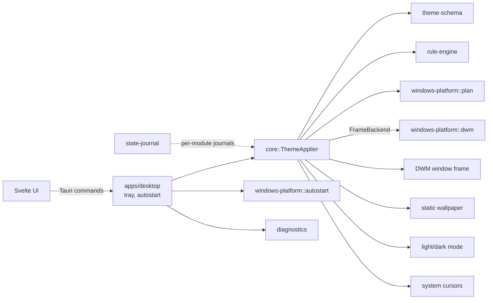

# Veneer

Veneer is an experimental Windows 10/11 desktop appearance manager. Its design
uses documented Microsoft APIs only. Features that Windows does not expose
through a supported API will be identified as unavailable rather than
implemented with undocumented hooks or process injection.

> **Early development:** Veneer applies DWM frame styles to its own window,
> static wallpapers, best-effort light/dark mode, and system cursors. Global
> changes are journaled and can be reverted; third-party windows are not styled.

## Project layout

- `apps/desktop` — Tauri and Svelte configuration UI.
- `crates/ipc` — versioned request/response types shared across process
  boundaries.
- `crates/theme-schema` — versioned JSON theme format: strict parsing and
  validation (pure, no I/O). Example: `themes/examples/midnight-work.json`.
- `crates/rule-engine` — deterministic, CSS-like cascade that resolves which
  style applies to a window at a given time (pure).
- `crates/state-journal` — write-ahead journal of original system state with
  atomic saves and crash recovery (module-agnostic, keeps the first snapshot).
- `crates/diagnostics` — structured JSON logging (`VENEER_LOG=debug` to raise
  verbosity).
- `crates/windows-platform` — Windows build detection and DWM window-frame
  styling. Planning (`plan`) is portable; applying (`dwm`) is Windows-only and
  records previous values so changes can be restored.
- `crates/core::applier` — `ThemeApplier`: applies a theme's window frame and
  global settings together, undoes them.
- `crates/core::setting` — journaled global settings shared by the appearance
  and cursor modules, with startup recovery.
- `crates/core::wallpaper` — journaled wallpaper changes: the original is
  written to disk before the change and restored on revert, on exit, or at the
  next start after a crash.
- `windows-platform::wallpaper` — static wallpaper per monitor via
  `IDesktopWallpaper`, with capture/restore.
- `windows-platform::appearance` — app/system light-dark values with a
  `WM_SETTINGCHANGE` broadcast. This is best-effort: Windows uses these
  per-user registry values, but does not document them as a stable setter.
- `windows-platform::cursors` — documented `SetSystemCursor` and
  `SystemParametersInfo(SPI_SETCURSORS)` APIs; restores the user's configured
  cursor scheme on revert or startup recovery.
- `windows-platform::autostart` — per-user autostart via the HKCU Run key.
- `crates/core` — `Controller`: parse → check build/policy → resolve rules →
  apply, all checks before the first write; generic over a `FrameBackend` so it
  is tested without a real window.

## Development

Prerequisites: Rust 1.88+, Node.js 22+, npm, and the Windows build tools and
WebView2 runtime required by Tauri.

```powershell
npm --prefix apps/desktop install
npm --prefix apps/desktop run tauri dev
```

In another terminal:

```powershell
cargo test --workspace
cargo fmt --all -- --check
cargo clippy --workspace --all-targets -- -D warnings
```

## Architecture



Decisions are recorded in [docs/adr](docs/adr).

## Measuring resource use

Start Veneer, leave it idle in the tray, then run
`powershell -File scripts/measure.ps1 -Seconds 60` (process CPU, working set,
and private memory). Run a separate sample while applying/reverting themes to
record load behaviour. Results are not yet published: this environment cannot
launch the Windows desktop app, so no idle or load numbers are claimed.
The requested before/after GIF also needs capture from a real Windows session;
do not treat a UI mockup as evidence that DWM/global changes were applied.

## Current limitations

- Wallpaper: set from the theme's optional `"wallpaper": {"path": "C:\\...\\img.jpg"}`
  (absolute path; jpg/jpeg/png/bmp/tif/tiff; no gif/video). It is global, not
  per rule, set on all monitors, replaced/undone when another theme is applied
  or on "Annulla"/"Esci", and refused when any monitor currently shows a solid
  color or slideshow, because that state cannot be restored. Policy `warn`
  keeps the frame styled if the wallpaper fails; `error` rolls everything
  back. Crash recovery is covered by tests with a fake backend, not yet by
  killing the real app.
- Appearance: optional `appearance.apps` and `appearance.system` values
  (`"light"`/`"dark"`), applied through the per-user Personalize registry
  values and `WM_SETTINGCHANGE`. This is best-effort because Windows does not
  promise those values as a stable public setting API; a future release may
  ignore them. Use `"unsupported": "warn"` (the example default) to keep other
  theme parts working if the setting is refused.
- Cursors: optional `cursors` map from system cursor role to an absolute `.cur`
  or `.ani` path. Revert reloads the configured cursor scheme via
  `SPI_SETCURSORS`; cursor replacement is session-wide and not per-monitor.
- Themes apply end to end only to Veneer's own window (one-click apply/revert
  in the preview panel). Other applications' windows are not styled.
- Closing the window hides it to the tray; use the tray's "Esci" to quit (this
  reverts applied styles). With autostart the window may flash briefly before
  being hidden.
- DWM color attributes cannot be read back; restore uses the system default.
- DWM attributes die with the window, so a crash needs no recovery for them;
  wallpaper, appearance, and cursor modules use separate journal files and
  attempt recovery at startup. A restore is skipped when the window no longer
  exists or its handle now belongs to a different thread; a handle reused by
  another window on the same thread is not detected.
- Global display filters and animated desktop wallpapers are not offered:
  no supported API provides an arbitrary full-screen filter or an animated
  desktop renderer.
- DWM attributes are per-window. Support and appearance vary by Windows build;
  no support for styling arbitrary third-party windows is assumed.
- CPU/RAM figures and a real before/after GIF are not yet captured. The
  installer is not signed, and there is no auto-update or multi-monitor
  behaviour testing.
