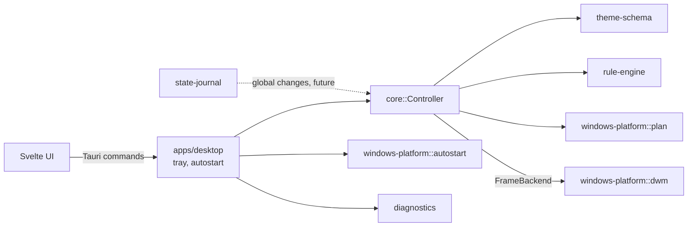

# Veneer

Veneer is an experimental Windows 10/11 desktop appearance manager. Its design
uses documented Microsoft APIs only. Features that Windows does not expose
through a supported API will be identified as unavailable rather than
implemented with undocumented hooks or process injection.

> **Early development:** Veneer can apply a theme's window-frame rules (DWM)
> to its own window, with one-click revert. It does not yet change other
> Windows settings or style third-party application windows.

## Project layout

- `apps/desktop` — Tauri and Svelte configuration UI.
- `crates/ipc` — versioned request/response types shared across process
  boundaries.
- `crates/theme-schema` — versioned JSON theme format: strict parsing and
  validation (pure, no I/O). Example: `themes/examples/midnight-work.json`.
- `crates/rule-engine` — deterministic, CSS-like cascade that resolves which
  style applies to a window at a given time (pure).
- `crates/state-journal` — write-ahead journal of original system state with
  atomic saves and crash recovery (module-agnostic, keeps the first snapshot).
- `crates/diagnostics` — structured JSON logging (`VENEER_LOG=debug` to raise
  verbosity).
- `crates/windows-platform` — Windows build detection and DWM window-frame
  styling. Planning (`plan`) is portable; applying (`dwm`) is Windows-only and
  records previous values so changes can be restored.
- `crates/core` — `Controller`: parse → check build/policy → resolve rules →
  apply, all checks before the first write; generic over a `FrameBackend` so it
  is tested without a real window.

## Development

Prerequisites: Rust 1.88+, Node.js 22+, npm, and the Windows build tools and
WebView2 runtime required by Tauri.

```powershell
npm --prefix apps/desktop install
npm --prefix apps/desktop run tauri dev
```

In another terminal:

```powershell
cargo test --workspace
cargo fmt --all -- --check
cargo clippy --workspace --all-targets -- -D warnings
```

## Architecture



Decisions are recorded in [docs/adr](docs/adr).

## Measuring resource use

Start Veneer, leave it idle in the tray, then run
`powershell -File scripts/measure.ps1 -Seconds 60` (CPU and memory of the
process). Results are not yet published; no idle numbers should be assumed.

## Current limitations

- Themes apply end to end only to Veneer's own window (one-click apply/revert
  in the preview panel). Other applications' windows are not styled.
- Closing the window hides it to the tray; use the tray's "Esci" to quit (this
  reverts applied styles). With autostart the window may flash briefly before
  being hidden.
- DWM color attributes cannot be read back; restore uses the system default.
- DWM attributes die with the window, so a crash needs no recovery for them;
  the journal exists for global changes (accent, cursors, wallpaper) that are
  not wired in yet. Window handle reuse is not yet guarded against.
- Global display filters and animated desktop wallpapers require a separate
  feasibility decision; the documented wallpaper API supports static images
  and slideshows, not an arbitrary animated desktop renderer.
- DWM attributes are per-window. Support and appearance vary by Windows build;
  no support for styling arbitrary third-party windows is assumed.
- CPU/RAM figures are not yet measured or published, the installer is not
  signed, and there is no auto-update or multi-monitor behaviour testing.
